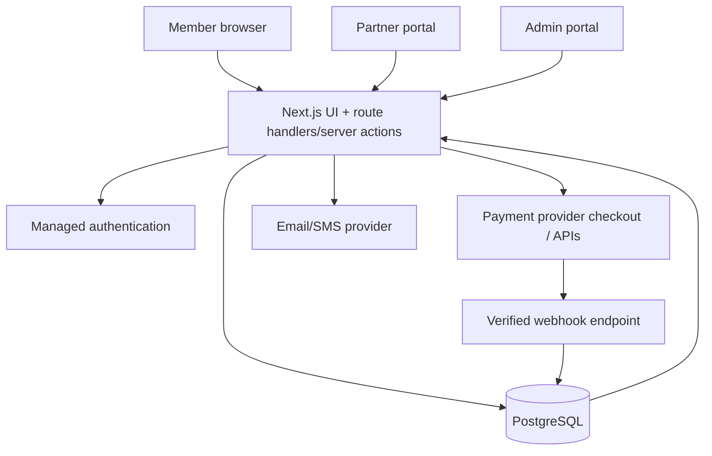

# Inlo — Technical Architecture

> **Architecture principle:** Start with a modular monolith and a reliable relational core. Scale only after measured constraints require it. This product’s hardest technical problems are transactional correctness, inventory accuracy, credit accounting, payment reconciliation and partner operations—not microservice count.

## 1. Recommended MVP stack

| Layer | Default recommendation | Why / boundary |
|---|---|---|
| User-facing web | Next.js App Router + React + TypeScript | Responsive consumer web/PWA-style experience; server rendering where useful; shared code across member, partner and admin routes |
| Styling / UI | Tailwind CSS + localised shadcn/ui primitives + Lucide | Customisable, maintainable accessible primitives; enforce `design.md` rather than accept library defaults |
| Forms / schema validation | Zod or equivalent shared schema validation | Validate inputs at the server boundary; client validation is for UX only |
| Primary database | Managed PostgreSQL (Supabase is a practical candidate) | ACID transactions, relational constraints, auditability, row-level security, atomic booking/ledger operations |
| Authentication | Supabase Auth or comparable managed auth | Avoid custom password/auth infrastructure; provider selection and OTP configuration must be tested in India |
| File storage | Private object storage for private documents; public bucket/CDN only for approved public venue imagery | Never put KYC documents or private user data in a public bucket |
| Deployment | Vercel for the Next.js app; managed Postgres in an appropriate India/nearby region subject to vendor/legal review | Reduce ops work for a small team; pin and document region/data-processing decisions |
| Payments | Razorpay or Cashfree only after commercial model review and a confirmed supported product flow | Server-created orders, provider checkout, verified server-side payment events; provider selection is not assumed final |
| Email | Resend or comparable transactional email provider | Notifications and receipts; store delivery results where needed |
| SMS/OTP | Auth-provider-supported SMS vendor, e.g. MSG91/other compliant vendor after testing | Verify delivery/retry cost and India template/sender requirements before live launch |
| Error monitoring | Sentry or equivalent plus hosting/database logs | Error reports must never leak secrets or full personal/payment payloads |
| Analytics | Privacy-conscious product analytics after consent/notice review; initially basic event capture + SQL reports | Keep event definitions small and decision-oriented; no early data warehouse |
| Tests | Vitest/Jest, Testing Library, Playwright, database integration tests | Unit tests alone cannot prove transaction/concurrency correctness |

### Do not use for MVP
- Microservices, Kubernetes, Kafka, Elasticsearch/OpenSearch, data warehouse, service mesh, custom auth or custom payment processing.
- Redis as the authority for booking capacity or credit balances.
- Client-only booking logic, browser-only credit calculations or fake local persistence as production state.
- A second mobile app before responsive web validation.

## 2. Logical modules in one deployable application

Keep code separated by domain even while shipping one web application:

1. **Identity and access:** profiles, sessions, roles, partner membership and permissions.
2. **Catalogue:** activity categories, venues, amenities, images, listing status and location metadata.
3. **Inventory:** operating hours, slot generation, capacity, blackouts and venue-side changes.
4. **Pricing and entitlements:** membership/pack rules, server-side quote, eligible credit lots, expiries and adjustments.
5. **Booking:** holds if needed, confirmed bookings, cancellation, no-show, check-in and completion.
6. **Payments:** provider orders, payment references, webhook inbox and reconciliation statuses.
7. **Credit ledger:** append-only grants/debits/refunds/expiries/adjustments and balance projection.
8. **Partner operations:** partner onboarding status, staff access, statements and settlements.
9. **Notifications:** transactional email/SMS and in-app notifications.
10. **Administration/audit:** moderation, support workflows, exception resolution and audit history.

Use clear domain folders such as `src/features/bookings`, `src/features/credits`, `src/features/payments` and `src/features/venues`. Do not create an abstraction or service just because it sounds enterprise-grade.

## 3. Context and request flow

**Trust boundaries:** Every role-controlled read and mutation is authorised on the server and/or by database RLS. Browser state is presentation only. The payment provider is authoritative for payment status, but the app’s database is authoritative for which entitlement/booking effect has already been applied.

## 4. Data model — core entities

Use UUID primary keys unless there is a documented reason otherwise. Use UTC timestamps internally; display the venue-local time to the user. Use integer credit quantities and integer paise for amounts (or a well-defined decimal type where exact currency arithmetic is needed); never use binary floating point for money.

Core tables (names can be adapted, relationships cannot be casually removed):

- `profiles`: `id` linked to auth identity, display name, phone/email fields permitted by the auth model, timestamps.
- `user_roles`: explicit role grants; role changes audited. Do not trust a client-writable profile field like `is_admin`.
- `partners`: business profile, onboarding status, contract metadata reference, payout readiness status; do not store unnecessary raw banking/KYC secrets.
- `partner_members`: user ID, partner ID, scoped role. Enables one user to support one or more explicitly assigned partner organisations.
- `venues`: partner ID, slug, name, description, approved listing status, address/locality, approximate coordinates if needed, contact/access instructions, image references.
- `activities`: controlled taxonomy (gym, yoga, swimming, badminton, etc.).
- `venue_activities`: venue-to-activity link, activity-specific attributes and eligibility rules.
- `venue_images`: storage path, approval state, ordering, alt text and ownership.
- `availability_slots`: venue/activity reference, `starts_at`, `ends_at`, `capacity`, `reserved_count` or an equivalent single source of occupancy truth, booking cutoff, status, pricing reference, version/timestamps. Add constraints for sensible time ranges and non-negative remaining capacity.
- `membership_products`: display/product configuration, price in paise, currency, entitlement terms version, active dates/status. Avoid baking every price into frontend code.
- `orders`: user, provider/order reference, amount paise, currency, purpose/product, payment status and idempotency key.
- `payment_events`: provider event ID (unique), provider reference, verified timestamp, payload digest or appropriately minimised payload, processing status/error. Do not retain unnecessary payment personal data.
- `credit_accounts`: optional transactional balance projection per user/type; not the only source of truth.
- `credit_lots`: source order/plan/promotion, granted credits, remaining/consumed/expired allocation, expiry and eligibility. Needed if credit types or expiry order differ.
- `credit_ledger`: immutable entries with user, delta, currency/credit type, entry type, source reference, booking/order reference, actor, reason, idempotency key (unique in appropriate scope), created timestamp. Insert reversal entries; do not rewrite history.
- `bookings`: member, slot, venue/partner, status, quoted and committed credits, booking idempotency key, confirmation time and immutable snapshots of venue/slot/policy details.
- `booking_events`: append-only timeline of status transitions, actor, reason and timestamp.
- `checkins`: booking, token hash/reference, issued/expiry time, used timestamp, staff actor and result. Do not store a reusable QR secret in public data.
- `cancellation_policies` / `policy_versions`: rules with effective time; every booking references the policy version shown to the user at confirmation.
- `partner_statements` / `settlement_items`: approved financial calculations and reconciliation status. Keep settlement records separate from the credit ledger; credits are not a substitute for accounting.
- `audit_log`: actor, action, target type/ID, timestamp, reason, correlation/request ID and safe metadata.

### Constraints and indexes
- Unique provider order/payment/event identifiers in their correct provider scope.
- Unique idempotency keys for booking/payment effects in their correct user/operation scope.
- Foreign keys between bookings, users, slots, venues and ledger references.
- Check constraints for non-negative balances/capacity where applicable.
- Index `availability_slots(venue_id, starts_at, status)`, `bookings(user_id, starts_at/status as query patterns need)`, `bookings(slot_id, status)`, `venues(status, locality/activity access path)` and ledger user/time/source references.
- Avoid duplicating the source of truth for capacity. If a count is maintained, update it in the same transaction as booking status and test it against derived occupancy.

## 5. Critical flow: safe booking + credit debit

The browser may request a booking with `slotId` and an idempotency key. It must not choose the final credit cost or user balance.

Recommended flow:
1. Authenticate request and check member role, account state and rate limits.
2. Validate request schema, idempotency key and booking eligibility.
3. Open a database transaction or call a reviewed PostgreSQL RPC that performs all critical steps atomically.
4. Read/lock the slot row (`SELECT ... FOR UPDATE`) or use an equivalent guarded atomic update.
5. Look up the idempotency key. If the same request already committed, return the original booking result.
6. Check slot active status, venue approval, booking cutoff and remaining capacity.
7. Recalculate the authoritative credit cost from the server-side price rule and slot context. Save a quote snapshot to the booking.
8. Lock/recalculate eligible credit lots or the account row. Verify sufficient valid credits; do not accept a balance submitted by the client.
9. Create the booking, consume credits from the correct lots, append ledger debit, update the capacity source of truth and append booking event.
10. Commit. Send notifications after commit; notification failure must not roll back a valid booking.
11. Return confirmed booking from the authoritative database result.

**Do not use a Redis lock as the only correctness mechanism.** The database transaction/constraints must prevent overselling even if cache is empty, stale or unavailable. Redis may be introduced later for caching but cannot override committed DB state.

### Failure and retry behaviour
- If any critical step fails, roll back booking, capacity and debit together.
- If request timeout occurs after commit, same idempotency key must recover the result.
- If capacity is lost in a race, return a clear conflict response and refresh available slots.
- If the member has insufficient valid credits, no slot is consumed and no booking is created.
- If the provider/client gets a network error after user confirmation, the UI must query booking state instead of guessing.

### Holds
Prefer no hold for the first pilot if bookings confirm instantly and slot capacity is simple. If the user must go through an external payment or partner approval before final booking, implement a **server-side expiring hold** with a unique hold ID and scheduled expiry/reconciliation. The frontend countdown is display-only; only the server can expire/release a hold.

## 6. Critical flow: payments and credit grants

1. Client asks server to create an order for a known, active product.
2. Server reads the product price/terms from the database and creates the provider order using server credentials.
3. Client receives only the provider checkout details that are intended to be public.
4. User completes checkout through provider-hosted/approved UI. Never collect or log raw card data, CVV, UPI PIN or bank credentials.
5. Redirect success page displays “verifying payment” until server/provider result is confirmed.
6. Webhook endpoint reads the **raw request body**, verifies the provider signature with the correct secret and performs schema checks.
7. Store provider event id once; duplicate delivery returns a safe success response without repeating the effect.
8. Check expected order ID, amount, currency, intended user/product, event type and current payment/order state. Fetch payment/order from provider when required by the integration’s documented approach.
9. In one DB transaction: record the captured payment/order state, issue the correct entitlement/credit lot, append ledger grant and audit/reconciliation event.
10. Notify the user after transaction commit. Reconcile unresolved, duplicated, failed and refunded payment events operationally.

Payment webhook signatures must be validated according to the selected provider’s current documentation. For Razorpay this includes HMAC-SHA256 signature validation using the raw body and webhook secret; do not parse and reserialise the body before checking the signature.

### Refunds and disputes
- A provider refund is a separate state/event; do not assume a user cancellation automatically means a monetary refund.
- Define whether a refund reverses unused credits, invalidates a membership period, or creates a separate compensation entry. Avoid deleting original grants/debits.
- Reconcile chargebacks and refunds against already-consumed credits; flag exceptions for operations rather than producing an unbounded negative balance silently.

## 7. Pricing, pass scans and credit allocation

### 7.1 Recommended MVP shape: hybrid, not universal duration billing

Use fixed server-quoted prices for bookable time slots/classes/courts. Permit duration metering only for a category/venue where the partner contract and pilot data justify it (likely open gym, subject to validation). A scan is an attendance event; it is not itself the pricing policy.

Every metered visit requires a server-generated quote containing:
- member, venue, activity and booking/entitlement reference;
- versioned rate-card ID and effective version;
- rate unit, rounding increment, minimum charge and estimate;
- hard maximum credit debit and quote expiry;
- cancellation/no-checkout terms accepted by the member;
- idempotency key and unique visit/session ID.

The client renders the quote; only server code decides eligibility, rate, duration, cap and ledger effect.

### 7.2 Data model additions

Add or adapt these entities in the existing PostgreSQL schema (follow current migration naming and repository conventions):

- `rate_cards`: venue/activity, rate unit, integer credit rate, rounding policy, minimum charge, maximum duration/debit, active interval, policy version, actor and audit timestamps.
- `usage_sessions`: id, member, venue, optional booking, status, accepted rate-card version, quote/maximum, server start/end timestamps, calculated billable units, final debit, exception code and lifecycle timestamps.
- `scan_events`: unique event ID, session, venue, actor/staff/device, action (`ENTRY`/`EXIT`/`STAFF_OVERRIDE`), server receipt time, optional signed client timestamp for diagnostics only, idempotency key, validation outcome and audit metadata. Avoid storing unnecessary device fingerprints.
- `usage_adjustments`: append-only proposed/approved correction, reason, evidence reference, actor, approver, old calculation and compensating ledger entry. Separate proposer and approver for material changes where staffing allows.
- `pricing_policy_acceptances`: member, quote/rate-card version, accepted terms, accepted timestamp and booking/session reference.

Use foreign keys, unique constraints, state checks and indexes. Do not store credit rates as floating point. Do not rely on a mutable `walletBalance` column as the source of truth.

### 7.3 Entry/exit flow

1. Member opens the pass/booking screen. The server issues a short-lived, scoped token or validates a booking-bound pass. A static venue QR can identify the venue but must not be sufficient by itself to authenticate a member or authorise a debit.
2. Staff/venue scanner or the member flow submits the scan action with session/booking reference and idempotency key. Server authenticates the actor, verifies the venue relationship, token freshness, booking/entitlement eligibility and session state.
3. On entry, a transaction creates exactly one active usage session and persists the accepted rate-card version, quote and hard cap. Return the confirmed start time and session state.
4. On exit, the server uses its own received/validated timestamp and the accepted rate-card rules to compute billable duration. It must enforce minimum, rounding and cap in one transaction, then append one debit ledger entry and mark the session completed.
5. If exit is missing, the system stops at the disclosed cap and flags an exception. It must not silently continue accruing. Operations may resolve the exception through a reasoned, audited adjustment; any additional debit needs separate policy/legal approval and explicit member notice/authorisation.
6. Repeated requests return the prior result for the same idempotency key. Duplicate exit after completion cannot create another debit. Out-of-order exit, wrong venue, expired token, second concurrent active session or invalid state is rejected with a stable error code.

### 7.4 Time, rounding and consistency

- Server UTC timestamps are authoritative; venue timezone is for display and rate-card schedules.
- Define whether billing rounds up to a fixed increment, has a grace period, or charges a minimum. Do not leave this implicit.
- Calculate with integer units and deterministic integer arithmetic; no floating-point currency/credit math.
- Store the raw start/end event timestamps, computed duration, billable increments, rate, cap and formula/policy version for audit/reproduction.
- Enforce atomicity across session completion, credit debit, ledger entry and booking state. Use a DB transaction/locking/unique constraints, not front-end sequencing.
- Use an append-only ledger for grants, debits, refunds, expiry and adjustments. Balance projections must be reconciled against ledger totals.
- Debit allocation across expiring credit lots must be deterministic and recorded, e.g. eligible expiry-first; policy remains unset until approved.

### 7.5 Security and operational trade-offs

- QR payloads should contain opaque, short-lived, scoped tokens—not personal data, raw member IDs or reusable secrets.
- A venue’s printed static QR is easy to copy; for high-risk use, pair it with staff confirmation, a rotating display QR, a booking-bound token or another proportionate presence check. Choose after threat modelling and partner usability tests.
- Do not claim GPS proves presence. Do not require precise location permission just to browse.
- Online server validation is the MVP default. Offline scans introduce clock manipulation, replay and conflicting sessions; defer offline mode unless venue connectivity data proves it necessary. If added, use signed event envelopes, short validity, local encrypted storage, explicit pending state and reconciliation conflict handling.
- Rate-limit scan attempts and alert on repeated invalid tokens, rapid venue switching, duplicate active sessions and unusual adjustment rates.
- Keep support staff able to see why a debit was calculated without granting broad ability to rewrite ledger history.

## 8. State machines

### Booking states
Suggested initial states: `CONFIRMED`, `CHECKED_IN`, `COMPLETED`, `CANCELLED`, `NO_SHOW`, `VENUE_CANCELLED`, `DISPUTED`.

Optional states only if the product requires them: `HOLD_PENDING`, `PENDING_PARTNER_CONFIRMATION`, `EXPIRED`, `FAILED`.

Rules:
- All state changes go through a server-side transition function with a reason and actor.
- `COMPLETED` and `NO_SHOW` are terminal for ordinary user actions; corrections require audited admin workflow.
- `CANCELLED` / `VENUE_CANCELLED` trigger credit compensation only according to versioned policy.
- `CHECKED_IN` cannot be created by the member simply editing a URL or booking row.
- Do not store loosely validated free-form status strings in critical tables; use a DB enum/check or a validated constrained type.

### Payment states
At minimum: `CREATED`, `PENDING`, `CAPTURED`, `FAILED`, `REFUND_PENDING`, `REFUNDED`, `DISPUTED`, `RECONCILIATION_REQUIRED`.

Use documented transitions. Webhook arrival order may differ from business order; do not let an old failure event overwrite a confirmed capture without checking provider and transaction state.

## 9. Security and privacy baseline

- Secrets only in deployment environment/secret manager. Never use a `NEXT_PUBLIC_` variable for DB service-role keys, payment secrets, signing secrets or private provider credentials.
- Use managed authentication; enforce authorization on every server endpoint and database policy, not just in navigation.
- Enable Row Level Security for tables exposed to browser/API access. Review every policy with positive and negative tests. Supabase documentation explicitly warns that tables in exposed schemas without RLS can be accessed by roles with grants.
- Keep privileged service-role connections on the server only; use them narrowly and add explicit authorization before invoking privileged operations.
- Validate all external/request input server-side with schemas; parameterise DB queries; render user text safely.
- Apply rate limits to OTP, sign-in, search, booking, check-in, cancellation, and admin endpoints.
- Verify webhook signatures; use unique provider event IDs and idempotency keys.
- QR/check-in tokens must be unguessable, scoped, time-limited where appropriate, and single-use. Store hashes if practical.
- Audit sensitive changes. Avoid logging OTP, passwords, full payment payloads, private KYC documents, access tokens or full personal records.
- Encrypt in transit and use provider-managed at-rest encryption. Restrict production database access and require MFA for high-privilege human accounts.
- Have a retention/deletion workflow and privacy notice before real users. Determine the applicable Indian DPDP Act/Rules obligations and effective dates with counsel; do not assert blanket data localisation without a legal/vendor assessment.
- Partner verification and payout design require a deliberate data-minimisation and access-control approach.

## 10. API boundaries

Use namespaced server routes/route handlers or equivalent typed server operations. Example endpoints (adapt as implementation evolves):

- `GET /api/venues?activity=&locality=&date=` — public approved venue catalogue.
- `GET /api/venues/:slug` — venue details and policy disclosures.
- `GET /api/venues/:id/availability?from=&to=` — server-calculated available slots and quotes.
- `POST /api/bookings` — authenticated, idempotent booking request.
- `GET /api/bookings` — current member’s bookings or partner-authorised subset.
- `POST /api/bookings/:id/cancel` — policy-controlled transition.
- `POST /api/bookings/:id/check-in-token` — authorised check-in token retrieval/issue, if required.
- `POST /api/check-ins/entry` — authenticate and open a usage session using a valid pass/venue context; idempotent.
- `POST /api/check-ins/exit` — close an active usage session, calculate capped usage and post one ledger debit; idempotent.
- `POST /api/check-ins/redeem` — partner-staff/admin redeem token for fixed-session experiences.
- `POST /api/payments/orders` — create provider order from a server-owned product.
- `POST /api/webhooks/:provider` — raw-body signature verification, event inbox and idempotent processing.
- `GET /api/partner/venues` — venues accessible to current partner user.
- `POST /api/partner/slots` / `PATCH /api/partner/slots/:id` — scoped inventory management.
- `GET /api/admin/reconciliation` — admin-only unresolved payment/ledger exceptions.

Contract requirements:
- Use stable error codes such as `SLOT_UNAVAILABLE`, `INSUFFICIENT_CREDITS`, `BOOKING_CUTOFF_PASSED`, `PAYMENT_PENDING`, `NOT_AUTHORISED` and `IDEMPOTENCY_CONFLICT`.
- Return safe user messages; never expose SQL, provider secrets or stack traces.
- Use idempotency keys for non-idempotent POST operations. Same key + same request returns the same result; same key with a different request returns a conflict.
- Add pagination for growing lists and enforce server-side result limits.
- Document timezones, currency units and integer-credit semantics. Check-in/exit APIs must never accept a client-supplied final duration, credit amount, rate or cap as authoritative.

## 11. Availability, pricing and search

MVP search should use PostgreSQL indexes and controlled filters. Do not add a dedicated search engine before evidence of a bottleneck.

- Prefer server-side query with approved venue, activity, date, locality and availability constraints.
- Store coordinate/address information as needed for locality filtering. Adopt PostGIS only if its spatial query value is proven and its extension/setup is verified in the selected managed Postgres provider.
- Distinguish catalogue search (“venue exists”) from bookable inventory (“slot available at selected time”).
- Availability display can be cached cautiously; the final booking always checks live DB state.
- Pricing decisions are server-owned and quote results include a price/terms version or snapshot.
- Do not implement unconstrained machine-learning dynamic pricing in MVP. Start with fixed/admin-controlled rates and measure supply utilisation and unit economics.

## 12. Scheduling, notifications and background work

MVP can use provider webhooks and simple scheduled jobs/cron for low-volume background tasks. Add a managed queue only when retry volume, durability or throughput justifies it.

- Notifications happen after successful DB commits.
- Store notification status and retry failed sends with bounded exponential backoff.
- Make scheduled expiry/no-show jobs idempotent.
- If jobs can be missed, build a reconciliation pass to discover overdue holds or stale states.
- Never rely on client-side timers to expire holds, memberships or credit lots.

## 13. Environments and delivery

- Environments: local, preview/staging, production; separate provider keys and database projects/schemas as appropriate.
- Production data is never copied to a developer environment without a reviewed anonymisation process.
- Use migrations committed to version control; do not manually mutate production schema as the normal path.
- CI should run lint, type-check, unit tests, database tests, critical Playwright flows and build.
- Deploy via preview/staging, verify migrations and payment test mode, then production.
- Maintain backups and test restore, not just backup creation.
- Feature-flag risky features such as payments, live payouts, category expansion and subscription renewals.

## 14. Scale-up path (only after product evidence)

1. Add durable managed queue/outbox pattern for webhooks, notifications, settlement jobs and retries when synchronous work creates operational risk.
2. Add caching for read-heavy catalogue/availability queries with short TTLs and strict invalidation rules; Postgres remains authority.
3. Add a search index only if query latency/quality metrics justify it.
4. Separate analytics workloads from transactional DB when measured query load warrants a warehouse.
5. Split modules/services only when team ownership, deployment cadence or traffic boundaries justify the operational cost.
6. Build mobile apps if repeat use, notification need and mobile UX results support investment.

## 15. Key architecture decisions to record

Use `docs/adr/` or an equivalent decision log for:
- Chosen payment provider/product and compliant money flow.
- Credit-unit commercial/legal interpretation and accounting model.
- Slot/hold strategy and capacity model.
- Auth provider, phone OTP and role assignment model.
- Hosting, region, data processing and privacy/retention decisions.
- Venue settlement method and payout reconciliation.

Do not merge secrets, real credentials or personal documents into the repository. No production rollout until the critical controls and release gates in `rules.md` and `phases.md` are met.
